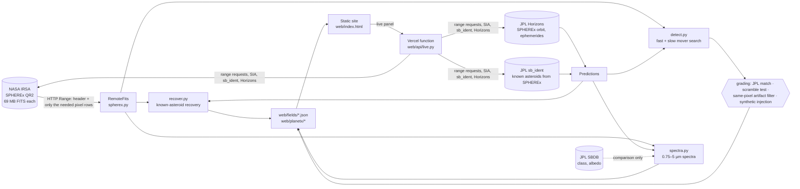

# SPHEREx Moving Sky

**Live demo: https://spherex-moving-sky.vercel.app**

NASA Space Apps Challenge 2026, challenge *[Planet X and SPHEREx](https://www.spaceappschallenge.org/2026/challenges/planet-x-and-spherex/)*.

This is a public web tool for finding things that move in NASA SPHEREx all-sky images. It covers fast main-belt asteroids, the slow distant movers a Planet X would be (tested on the real dwarf planet Makemake, at 52.7 au), and a spectrum for each asteroid. Every result is graded against JPL's catalogue.

- How it works (read this before judging): [HOW_IT_WORKS.md](HOW_IT_WORKS.md)
- Response to external review: [REVIEW_RESPONSE.md](REVIEW_RESPONSE.md)
- Pitch, video script and judge Q&A: [PITCH.md](PITCH.md)

## Architecture

The heavy pipeline (Python) runs ahead of time and writes JSON. The site is static, except for the **live panel**: it calls `web/api/live.py`, a serverless function using only the standard library, which queries IRSA and JPL on demand and returns the exact byte ranges it read.

## NASA and JPL data used
| Source | What we use | Reference |
|---|---|---|
| **SPHEREx Quick Release 2**, NASA/IPAC IRSA | Level-2 spectral images: IMAGE, VARIANCE, FLAGS, PSF (121 zones), WCS-WAVE (per-pixel wavelength) | [DOI 10.26131/IRSA652](https://doi.org/10.26131/IRSA652) |
| **IRSA SIA** (`spherex_qr2`) | Which exposures cover a sky position | [irsa.ipac.caltech.edu/SIA](https://irsa.ipac.caltech.edu/SIA) |
| **JPL Horizons** | SPHEREx's own position (ID −163182); positions of bodies as seen from SPHEREx; Sun distances | [ssd-api.jpl.nasa.gov/doc/horizons.html](https://ssd-api.jpl.nasa.gov/doc/horizons.html) |
| **JPL Small-Body Identification** (`sb_ident`) | Known asteroids predicted inside each exposure, from SPHEREx's position | [ssd-api.jpl.nasa.gov/doc/sb_ident.html](https://ssd-api.jpl.nasa.gov/doc/sb_ident.html) |
| **JPL SBDB** | Published taxonomic class and albedo, used **only** to check our spectra | [ssd-api.jpl.nasa.gov/doc/sbdb.html](https://ssd-api.jpl.nasa.gov/doc/sbdb.html) |

## Run it
The site needs no build step. Serve `web/` with any static server; the live panel only works when deployed, because it needs the serverless function.
```bash
python3 -m http.server 8000 -d web
```
The pipeline needs Python 3.11+, numpy and astropy. All downloads are cached in `data/`.
```bash
python3 -m venv .venv && .venv/bin/pip install numpy astropy
.venv/bin/python survey.py      # 10 ecliptic field-passes: recovery + fast search + spectra
.venv/bin/python distant.py     # Planet X mode: Makemake and Haumea, plus synthetic injection
```
Each script runs its own self-checks (asserts) at the start.

## Files
| File | What it does |
|---|---|
| `spherex.py` | Data access: IRSA search, SPHEREx position, JPL known asteroids. `RemoteFits` reads pixel rectangles, wavelengths and per-zone PSFs from remote FITS files with HTTP range requests |
| `recover.py` | Known-asteroid recovery: measure at JPL's predicted pixel, confirm the spot is empty later. Robust (MAD) sky noise |
| `detect.py` | Blind search. **Fast mode**: outlier-flag seeds, 2–150″/h, 3+ visits. **Slow mode**: seeds missing from the median of the other visits, 0.3–3″/h, 4+ visits. Both: same-pixel artifact rejection, scramble false-alarm test, JPL matching, vetting stamps, PSF-based synthetic injection |
| `spectra.py` | Spectra across all six detectors at calibrated wavelengths, PSF-corrected; fits reflected sunlight with a slope plus heat (temperature set by the Sun distance); compares with JPL SBDB |
| `survey.py` | Runs the 10 field-passes, resumes if interrupted, combines the statistics, writes the headline numbers into the HTML |
| `distant.py` | Planet X mode on real dwarf planets, with an injection depth curve |
| `web/index.html` | The tool: blink viewer with stretch controls, vetting stamps, Planet X panel, tracks ledger with artifact log, spectra, live NASA console, candidate vetting and ADES export |
| `web/api/live.py` | Serverless live lookups (IRSA and JPL only, SPHEREx files only) |
